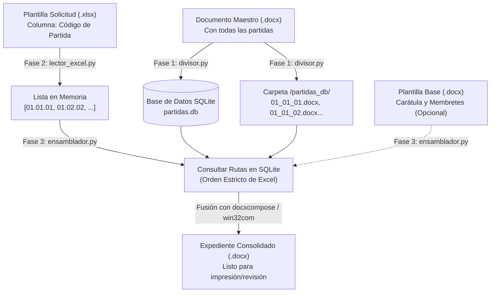

# Sistema Automatizado de Ensamblaje de Expedientes Técnicos

Sistema modular en Python diseñado para procesar especificaciones técnicas de obras y proyectos de ingeniería. Permite dividir un documento Word Maestro en partidas individuales sin perder formato (tablas, imágenes, estilos, sangrías), indexarlas en SQLite, leer solicitudes desde plantillas Excel y ensamblar expedientes consolidados a medida respetando el orden requerido.

---

## 🏗 Arquitectura del Sistema



---

## 📁 Estructura de Archivos del Proyecto

| Archivo | Rol | Descripción |
| :--- | :--- | :--- |
| [`divisor.py`](file:///storage/emulated/0/universida-datos/divisor.py) | **Fase 1 (Splitter)** | Divide el Word maestro aislando cada partida con tablas e imágenes y las registra en SQLite. |
| [`lector_excel.py`](file:///storage/emulated/0/universida-datos/lector_excel.py) | **Fase 2 (Excel)** | Lee el archivo `.xlsx`, localiza la columna requerida y extrae los códigos limpios. |
| [`ensamblador.py`](file:///storage/emulated/0/universida-datos/ensamblador.py) | **Fase 3 (Merger)** | Consulta SQLite en el orden del Excel y fusiona los archivos `.docx` en el documento final. |
| [`db_manager.py`](file:///storage/emulated/0/universida-datos/db_manager.py) | **Base de Datos** | Gestión de conexión SQLite, creación de tablas, inserción por lotes y consultas tolerantes. |
| [`main.py`](file:///storage/emulated/0/universida-datos/main.py) | **Orquestador** | Ejecuta el flujo integral (Fases 1, 2 y 3) en una sola llamada de terminal. |
| [`generar_ejemplo.py`](file:///storage/emulated/0/universida-datos/generar_ejemplo.py) | **Generador Demo** | Crea un maestro de prueba con tablas e imágenes, una plantilla con portada y un Excel de solicitud. |
| [`test_sistema.py`](file:///storage/emulated/0/universida-datos/test_sistema.py) | **Pruebas** | Suite de pruebas unitarias y de integración automatizadas (`unittest`). |
| [`requirements.txt`](file:///storage/emulated/0/universida-datos/requirements.txt) | **Dependencias** | Librerías de Python requeridas (`python-docx`, `docxcompose`, `pandas`, `openpyxl`, etc.). |

---

## ⚙️ Instalación de Requisitos

```bash
pip install -r requirements.txt
```

> [!NOTE]
> En entornos Linux/PRoot gestionados, puede requerirse `--break-system-packages` o trabajar dentro de un entorno virtual (`venv`).
> El sistema funciona de manera autónoma en Linux, macOS y Windows. En Windows, si se cuenta con Microsoft Word instalado, también puede aprovechar la automatización COM nativa (`win32com.client`).

---

## 🚀 Guía de Uso

### 1. Generar Datos de Prueba (Demostración Rápida)
Para verificar el sistema de inmediato con datos de prueba realistas (que incluyen tablas con sombreados e imágenes incrustadas):
```bash
python generar_ejemplo.py
```
Esto genera:
- `Maestro_Especificaciones.docx` (6 partidas con tablas técnicas y diagramas).
- `Plantilla_Base.docx` (Carátula formal de obra).
- `Solicitud_Partidas.xlsx` (Plantilla con columna "Código de Partida" y filas vacías de prueba).

---

### 2. Flujo Completo con el Orquestador (`main.py`)
Para ejecutar las tres fases de extremo a extremo:
```bash
python main.py \
  --maestro Maestro_Especificaciones.docx \
  --excel Solicitud_Partidas.xlsx \
  --plantilla Plantilla_Base.docx \
  --salida Expediente_Consolidado.docx
```

---

### 3. Ejecución por Fases Independientes

#### Fase 1: División y Almacenamiento (`divisor.py`)
Abre el Word maestro, detecta los encabezados mediante expresiones regulares, aísla el bloque íntegro y genera los `.docx` en `partidas_db/` registrándolos en SQLite:
```bash
python divisor.py -m Maestro_Especificaciones.docx -o partidas_db -d partidas.db --reset-db
```
**Parámetros:**
- `-m, --maestro`: Ruta del documento Word Maestro.
- `-o, --output-dir`: Directorio para los archivos `.docx` individuales (default: `partidas_db`).
- `-d, --db`: Ruta del archivo SQLite (default: `partidas.db`).
- `-r, --regex`: Expresión regular de numeración (default: `^\s*(\d+(?:\.\d+)+)\s*[-.:]?\s*(.*)$`).
- `-b, --backend`: `auto` (detecta el SO), `docx` (multiplataforma) o `win32com` (Windows COM).

#### Fase 2: Lectura de Solicitud Excel (`lector_excel.py`)
Lee el archivo `.xlsx`, detecta automáticamente variantes de la columna (con o sin tildes, mayúsculas, etc.), elimina nulos y muestra la lista en memoria:
```bash
python lector_excel.py -e Solicitud_Partidas.xlsx -c "Código de Partida"
```

#### Fase 3: Ensamblaje (`ensamblador.py`)
Consulta SQLite para recuperar las rutas en el orden exacto del Excel y genera el documento final consolidado:
```bash
python ensamblador.py \
  -e Solicitud_Partidas.xlsx \
  -p Plantilla_Base.docx \
  -d partidas.db \
  -o Expediente_Consolidado.docx
```
También permite indicar los códigos directamente por consola:
```bash
python ensamblador.py -l 01.01.01 02.01.01 -o Expediente_Rapido.docx
```

---

## 💡 Conservación Crítica de Formatos, Tablas e Imágenes

Para resolver el requisito crítico de **no perder formatos, tablas ni figuras**:

1. **Estrategia Multiplataforma (`docx` + Poda XML Quirúrgica):**
   - No extrae texto plano. Clona el archivo maestro completo como base de cada partida, lo que garantiza que el archivo hijo herede todas las fuentes, estilos (`styles.xml`), reglas de viñetas multinivel (`numbering.xml`), geometría de página y paquete de medios/imágenes (`word/media/*`).
   - Luego poda del cuerpo XML (`w:body`) únicamente los nodos externos al rango de la partida.
   - Como resultado, cualquier tabla compleja (bordes, anchos de columna, sombreado) y cualquier dibujo o imagen (`w:drawing`) se conserva intacto al 100%.

2. **Estrategia Windows Nativa (`win32com.client`):**
   - Si se ejecuta en Windows con Office Word instalado, interactúa directamente con `Word.Application` mediante COM, seleccionando el rango visual nativo y guardándolo con el formateador nativo de Microsoft Word.

3. **Fusión con `docxcompose` / `win32com`:**
   - En la Fase 3, `docxcompose` combina los diccionarios de estilos, reasigna los identificadores de relación (`rId`) de las imágenes para evitar colisiones y fusiona los árboles de documentos preservando los saltos de sección y márgenes de la plantilla.

---

## 🗄️ Esquema de la Base de Datos SQLite (`partidas.db`)

Tabla principal: `partidas`
```sql
CREATE TABLE partidas (
    id_partida TEXT PRIMARY KEY,       -- Ej: '01.01.03'
    nombre_partida TEXT NOT NULL,      -- Ej: 'DEMOLICIÓN DE ESTRUCTURAS'
    ruta_archivo TEXT NOT NULL,        -- Ej: 'partidas_db/01_01_03.docx'
    fecha_registro TIMESTAMP DEFAULT CURRENT_TIMESTAMP,
    num_parrafos INTEGER DEFAULT 0,
    num_tablas INTEGER DEFAULT 0,
    num_imagenes INTEGER DEFAULT 0
);
```

---

## 🧪 Ejecución de Pruebas Automatizadas

Para validar que todos los módulos y casos borde operen correctamente:
```bash
python test_sistema.py
```
Salida esperada:
```text
Ran 4 tests in 3.3s
OK
```
